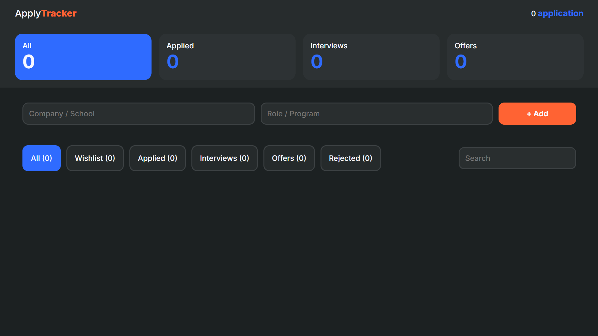

# ApplyTracker

A single-page React app for tracking every application you send: internships, jobs, and school admissions. Add an application, move it through the stages, and see where everything stands at a glance.

> **Status:** work in progress. Features marked below are checked off as they're built.

<!-- Save a screenshot to docs/screenshot.png and it will show here -->


**Live demo:** coming soon

---

## Why this project exists

People applying to many places at once lose track of deadlines, follow-ups, and which application is at which stage. Spreadsheets get messy, and general tools aren't built around the application process. ApplyTracker is a small, focused tool for students and junior developers who are applying to internships, jobs, and engineering or professional programs.

## Features

- [x] Summary counters (total, applied, interviews, offers)
- [x] Add an application with company/school and role/program
- [x] Filter bar with a count per status
- [ ] List of applications with status badges
- [ ] Move an application to the next status
- [ ] Delete an application
- [ ] Search by company or role
- [ ] Combine search and status filters
- [ ] Empty and no-results states
- [ ] Deadlines with upcoming and overdue indicators
- [ ] Notes and checklist per application
- [ ] Save data in the browser (localStorage)
- [ ] Export and import as JSON
- [ ] Responsive layout for desktop, tablet, and mobile
- [ ] Accessibility pass (keyboard navigation, contrast, labels)

**Statuses:** Wishlist, Applied, Interview, Offer, Rejected

## Built with

- [React](https://react.dev/): UI library
- JavaScript (ES6+)
- HTML5 and CSS3 (responsive layout, CSS variables for theming)
- [Vite](https://vite.dev/): dev server and build tool
- ESLint: code quality
- Git and GitHub: version control, Issues, and Pull Requests

No other libraries are used. Anything added later will be listed here with the reason.

## Getting started

### Prerequisites

- [Node.js](https://nodejs.org/) (a current LTS version; developed with v24)
- [Git](https://git-scm.com/)

### Run it locally

```bash
# 1. Clone the repository
git clone https://github.com/AnasChtioui4/<repo-name>.git

# 2. Go into the project folder
cd <repo-name>

# 3. Install dependencies
npm install

# 4. Start the development server
npm run dev
```

Then open the local address that Vite prints in your terminal (usually `http://localhost:5173`).

### Other scripts

| Command | What it does |
|---|---|
| `npm run build` | Creates an optimized production build in `dist/` |
| `npm run preview` | Serves the production build locally |
| `npm run lint` | Checks the code with ESLint |

## Project structure

Update this tree to match your actual folders.

```
src/
├── components/     Reusable UI pieces (ApplyCounter, CounterCard, ...)
├── css/            One stylesheet per component or page
├── App.jsx         Root component
└── main.jsx        Entry point
```

## Design

- **Palette:** a dark base (about 60%), electric blue as the supporting color (about 30%), and sunset orange as a small accent for key actions and attention states (about 10%)
- **Typography:** Inter
- **Approach:** colors are defined once as CSS variables and named by role (background, primary, accent), so the theme can change in one place

## Git workflow

This project follows a realistic team workflow, even though I'm working alone:

- `main` always holds working code
- Each feature or fix is developed on its own branch (for example `feature/search-filter`)
- Changes reach `main` through a Pull Request that I review before merging
- Tasks and bugs are tracked as GitHub Issues
- Commit messages follow a simple convention, such as `feat: add status filter` or `fix: pass counter values as numbers`

## What I learned

- Building a component tree and passing data down with props
- Managing state with `useState` and deriving values instead of duplicating them
- Controlled inputs versus refs
- Rendering lists with stable keys and handling conditional UI
- Structuring CSS with variables and building responsive layouts
- Using Git branches, Pull Requests, and Issues in a real workflow

## Roadmap

- Edit an existing application
- Drag and drop between status columns
- Dark and light theme toggle
- Deployment and a `v1.0.0` release

## Author

**Anas**, GitHub: [@AnasChtioui4](https://github.com/AnasChtioui4)

## License

Add a `LICENSE` file and name your license here (for example, MIT).
